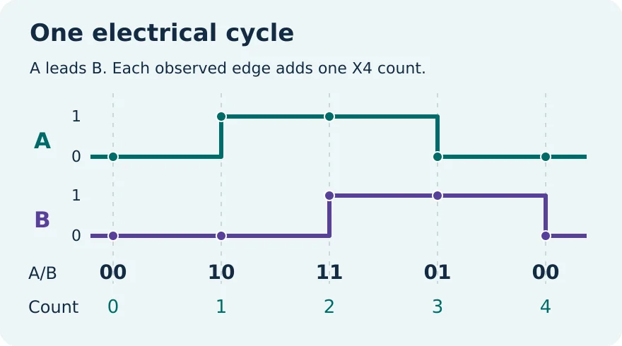
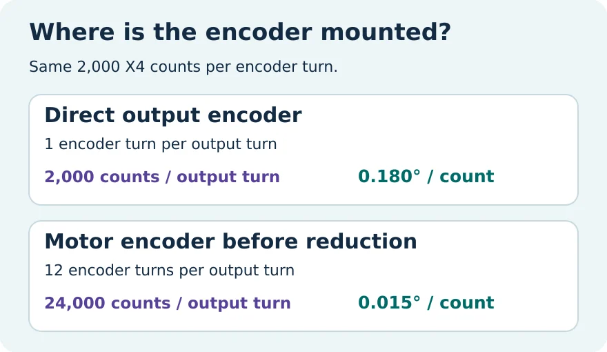

# Robot Encoder Resolution: An A/B Trace Lab

A robot joint moved less than the software reported. Can the difference come from the meaning of the encoder's count specification? Use a few synthetic A/B samples to separate the decoder setting from the gearbox ratio.



## Run it from a new folder

1. Install [Python 3.10 or later](https://www.python.org/downloads/). On Windows, use `py -3` instead of `python3` if that is how your launcher is installed.
2. On the repository page, choose **Code**, then **Download ZIP**. Extract it and open a terminal in the folder containing `encoder.py`.
3. Run these commands. The decoder and tests use only the Python standard library.

```sh
python3 --version
python3 encoder.py examples/forward.csv --cycles 500
python3 encoder.py examples/forward.csv --x4-counts 2000 --gear 12
python3 encoder.py examples/reverse-after-pause.csv --x4-counts 2000 --gear 12
python3 encoder.py examples/two-bit-jump.csv --cycles 500
python3 -m unittest discover -s tests -v
```

| Example | Observed edges | Unchanged samples | Net count | Nominal output step | Relative output angle |
|---|---:|---:|---:|---:|---:|
| Forward, direct | 4 | 0 | +4 | 0.180000° | +0.720000° |
| Forward, 12:1 reduction | 4 | 0 | +4 | 0.015000° | +0.060000° |
| Reverse after pause, 12:1 | 5 | 1 | −1 | 0.015000° | −0.015000° |
| Two bit jump | | | | | Exits with status 2; no angle |

The files start with `A,B`. Each row contains two bits in acquisition order. The first row defines the starting phase. Moving through `00, 10, 11, 01, 00` increases the count in this lab. Swapping the columns reverses the sign. Identical consecutive rows do not add an edge. A change in both bits is rejected: the intervening states and direction are unknown.

Use `--cycles` for the number of complete A periods in one turn of the encoder shaft. Use `--x4-counts` when the manufacturer or driver already specifies the count after X4 decoding. The program converts cycles to counts exactly once. The number in `--gear` means encoder turns per output turn, with 1 for an output mounted encoder and 12 for a motor encoder on a 12:1 reduction. A fraction such as `7/3` is also accepted. The ratio gives a nominal scale; it does not guarantee an identical integer edge count on every output turn for every fractional ratio.



## When a result looks wrong

- **Exactly four times off:** check whether the specification is cycles or already decoded counts. The letters CPR alone do not tell you.
- **Wrong sign:** inspect the A/B column order and match the sign convention to your controller documentation.
- **Two bit jump:** inspect the original capture. This tool will not invent the missing edges. Missing four edges can appear as an unchanged sample, so a valid trace does not prove capture completeness.
- **Wrong by the reduction ratio:** confirm which shaft carries the encoder and whether the ratio is written as input turns per output turn.
- **No angle after the jump example:** expected. Test the other files for successful output.

## Repository layout

`encoder.py` reads and audits the trace. `examples/` holds three synthetic captures. `tests/` covers known transitions, a generated motion oracle, scale factors, bad input and CLI behavior. `diagrams/` includes editable SVG drawings and the WebP files used here. To regenerate them, install Inkscape, make a virtual environment and install Pillow inside it, then run `python3 diagrams/render.py`. Those are diagram tools only.

[Full WIFA Robotics lesson](https://wifarobotics.com/learn/robot-encoder-resolution/) explains the examples step by step.

This lab reads files only. It does not acquire hardware signals, home an axis, estimate absolute angle, validate a motion system, or measure backlash, edge loss or accuracy. All example signals and mechanical values are synthetic.

References: [US Digital: resolution, accuracy and precision](https://www.usdigital.com/support/resources/reference/technical-docs/white-papers/resolution-accuracy-and-precision-of-encoders), [NI cDAQ user manual](https://docs-be.ni.com/bundle/cdaq-9188xt-features/raw/resource/enus/373929c.pdf).
